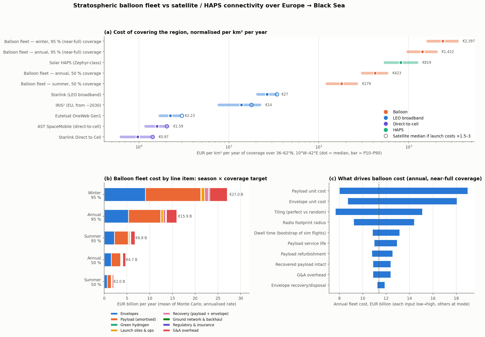

# Balloon fleet vs satellite connectivity — cost comparison

*Generated by `cost_model.py` (Monte Carlo, 20,000 draws + bootstrap over the 120 simulated "slow" flights). Ranges are median (P10 – P90). EUR, 2025-26 prices.*

## Verdict

**The balloon fleet is not cost-competitive with satellite coverage of this region.** Keeping ~95 % of the region covered year-round costs **€15.5 B (€10.6 B – €22.1 B) per year**, i.e. **€1,422 (€972 – €2,031) per km² per year** — about **53× Starlink's attributable cost** (34–82×), while delivering roughly 87 Gbps of radio capacity versus ~21 Tbps for Starlink's share over the same area. Per GB of deliverable capacity the gap is ~10,000× (€185 (€105 – €336) vs €0.014 (€0.010 – €0.022)).

Even the most favourable case we model — **summer winds, 50 % coverage** — costs €1.9 B (€1.3 B – €2.9 B)/yr, still 7× (4–11×) Starlink per km². The one thing balloons offer that broadband LEO does not is service to **unmodified phones** — but the direct-to-cell constellations (AST SpaceMobile, Starlink Direct to Cell) target exactly that at a far lower attributable cost per km², although with much less capacity per user today and not yet commercial in most of Europe.

Launch-market concentration (SpaceX flew about half of 2025's orbital launches; Ariane 6 manages a handful a year) is a real sovereignty and availability risk for the satellite options, and the balloon fleet's one structural advantage — it needs no launch vehicle. But stressing satellite launch costs ×1.5–3 moves them by under 2×, so it does not close the cost gap (see *Launch-market concentration* below).

**Why:** the fleet is a consumables business. Every flight (harmonic-mean 3.7 days over the region) burns a whole envelope and about a quarter of a payload, so cost ≈ balloons aloft ÷ dwell time × cost per flight (€38,675 (€28,522 – €50,683) all-in). That needs **1,100 (866 – 1,379) launches/day** (402 (316 – 503) k/yr) with 3,846 (3,077 – 4,720) balloons aloft.

### Key drivers

Season (winds) gives the largest swing across scenarios; within one scenario the biggest single-input swings are payload and envelope unit cost, then tiling and footprint (tornado, panel c).

1. **Dwell time, i.e. winter.** Launches scale with 1/dwell, so the year is governed by the *harmonic* mean dwell (3.7 d), not the arithmetic mean (5.4 d) quoted in the brief. Winter (Dec–Mar, harmonic 2.1 d; March 1.5 d) runs at €26.1 B (€17.6 B – €37.8 B)/yr annualised vs €6.4 B (€4.1 B – €9.8 B)/yr in summer (harmonic 9.1 d).
2. **Balloons cannot tile the region.** The brief's 310 launches/day assumes one balloon parked per 50 km cell. Station-keeping failed in our sims, so positions are closer to random; random coverage of 95 % needs ~3× as many balloons (−ln 0.05 ≈ 3.0). Footprint radius (Loon quoted ~40 km, we simulated 50 km) adds up to another ~1.6×.
3. **Envelope and payload unit costs.** Together 78 % of spend. Glider recovery (78 % in the sim) helps the payload line but the envelope is single-use by design.
4. **Hydrogen is not a driver**: 0.3 % of cost even at €8/kg green H₂ (13.8 kg/flight + losses).
5. **Coverage target**: 50 % instead of 95 % cuts cost ~3.4× (fewer balloons, and random placement is far less wasteful at low coverage).

## Balloon fleet: scenarios

Annualised rate (EUR/yr) if every month looked like the season shown.

| Season | Coverage | Launches / day | Balloons aloft | Annual cost | EUR / km² / yr |
|---|---|---|---|---|---|
| Annual (Jan-Dec) | 50 % | 321 (277 – 377) | 1,124 (997 – 1,277) | €4.6 B (€3.3 B – €6.3 B) | €423 (€304 – €575) |
| Annual (Jan-Dec) | 80 % | 662 (552 – 795) | 2,313 (1,976 – 2,701) | €9.4 B (€6.6 B – €13.0 B) | €863 (€610 – €1,195) |
| Annual (Jan-Dec) | 95 % (near-full) | 1,100 (866 – 1,379) | 3,846 (3,077 – 4,720) | €15.5 B (€10.6 B – €22.1 B) | €1,422 (€972 – €2,031) |
| Winter (Dec-Mar) | 50 % | 547 (458 – 664) | 1,124 (996 – 1,278) | €7.8 B (€5.5 B – €10.7 B) | €714 (€503 – €987) |
| Winter (Dec-Mar) | 80 % | 1,124 (918 – 1,394) | 2,309 (1,977 – 2,704) | €15.7 B (€11.0 B – €22.2 B) | €1,448 (€1,012 – €2,040) |
| Winter (Dec-Mar) | 95 % (near-full) | 1,871 (1,449 – 2,408) | 3,856 (3,074 – 4,714) | €26.1 B (€17.6 B – €37.8 B) | €2,397 (€1,616 – €3,478) |
| Summer (Jun-Aug) | 50 % | 132 (102 – 179) | 1,123 (994 – 1,277) | €1.9 B (€1.3 B – €2.9 B) | €179 (€122 – €264) |
| Summer (Jun-Aug) | 80 % | 271 (205 – 374) | 2,303 (1,974 – 2,698) | €3.9 B (€2.6 B – €5.8 B) | €356 (€239 – €537) |
| Summer (Jun-Aug) | 95 % (near-full) | 453 (329 – 639) | 3,858 (3,082 – 4,715) | €6.4 B (€4.1 B – €9.8 B) | €588 (€381 – €904) |

For reference, the brief's sizing (1,674 cells ÷ arithmetic-mean dwell 5.39 d, perfect tiling) gives 311 launches/day; the model above replaces both simplifications.

Simulated dwell per balloon ("slow" controller, mean days, n = 10 flights per month): Jan 2.4, Feb 2.1, Mar 1.5, Apr 6.1, May 6.5, Jun 14.0, Jul 9.0, Aug 6.8, Sep 6.7, Oct 3.3, Nov 3.3, Dec 3.1.

### Cost per flight (annual, near-full coverage)

| Line item | Share of cost (mean) | Per flight (median) |
|---|---|---|
| Envelopes | 33.2 % | €12,472 |
| Payload (amortised) | 44.5 % | €16,785 |
| Green hydrogen | 0.3 % | €127 |
| Launch sites & ops | 3.3 % | €1,267 |
| Recovery (payload + envelope) | 3.1 % | €1,175 |
| Ground network & backhaul | 0.4 % | €156 |
| Regulatory & insurance | 0.8 % | €320 |
| G&A overhead | 14.3 % | €5,405 |
| **Total** | 100 % | **€38,675 (€28,522 – €50,683)** |

### Physical footprint of the base case

* Green hydrogen: 6,433 (5,038 – 8,139) t/yr, needing 338 (264 – 428) GWh/yr of renewable electricity (~39 MW continuous electrolysis).
* **Polyethylene envelopes coming down: 27,510 (21,646 – 34,486) t/yr** across Europe, the Mediterranean and the Black Sea. This, not cost, may be the binding constraint (and is why burning at altitude, burn_sim.py, matters); envelope recovery is costed at €100–1,500 each but sea landings are largely unrecoverable.
* Launch sites: 50 (31 – 80) (sized for the peak month at 48 launches/site/day nominal).

## Comparator systems

Annual cost = annualised capex + opex, attributed to this region by its share of each system's served area (weighted for satellites bunching at high latitude) — a generous allocation to the satellites because they also serve the rest of the world from the same spend.

| System | Region-attributable cost / yr | EUR / km² / yr | EUR / GB* | What it delivers |
|---|---|---|---|---|
| **Balloon fleet (annual, 95 %)** | €15.5 B (€10.6 B – €22.1 B) | €1,422 (€972 – €2,031) | €185 (€105 – €336) | unmodified LTE phones, ~10–40 Mbps shared per balloon, ~20–40 ms; service gaps wherever balloons drift apart |
| Starlink (LEO broadband) | €289 M (€226 M – €364 M) | €27 (€21 – €33) | €0.014 (€0.010 – €0.022) | 100-300 Mbps/user, 25-60 ms; needs a dish terminal (USD 300-600); in service across Europe |
| Eutelsat OneWeb Gen1 | €24 M (€19 M – €31 M) | €2.23 (€1.70 – €2.82) | €0.40 (€0.24 – €0.69) | ~50-200 Mbps/terminal, 50-70 ms; enterprise/backhaul terminals only |
| IRIS² (EU, from ~2030) | €150 M (€84 M – €241 M) | €14 (€7.73 – €22) | n/a (capacity not public) | secure governmental + commercial broadband; not in service before 2030; terminals required |
| AST SpaceMobile (direct-to-cell) | €17 M (€13 M – €23 M) | €1.59 (€1.19 – €2.10) | n/a (capacity not public) | unmodified phones, broadband-class peaks claimed; Europe via Vodafone JV, not yet commercial here |
| Starlink Direct to Cell | €11 M (€7 M – €16 M) | €0.97 (€0.63 – €1.44) | n/a (capacity not public) | unmodified phones; text + low-rate data today (~4-18 Mbps per beam shared); needs an MNO spectrum partner per country |
| Solar HAPS (Zephyr-class) | €8.9 B (€5.9 B – €13.4 B) | €819 (€543 – €1,235) | €37 (€18 – €77) | unmodified phones (4G/5G D2D payload), ~7,500 km² each; solar aircraft cannot hold station at 36-62 N in winter today; pre-commercial |

\*EUR per GB of deliverable capacity at 25% (range 10%–40%) average utilisation. Capacity-based numbers for OneWeb and HAPS are rough assumptions.

**Reading the table.** Per km², every satellite option is 53× to 1,468× cheaper than the balloon fleet (medians), and Starlink also delivers ~245× more capacity. Solar HAPS land in the same cost range as the balloons and cannot yet fly a European winter. Direct-to-cell is the real like-for-like competitor (same phones), and it is cheap per km² because one satellite footprint is far larger than a balloon's — but its per-user throughput is currently low.

## Launch-market concentration: risk and availability

Satellite constellations need a launch vehicle for deployment *and* for continual replenishment (LEO satellites last ~5-12 years). That market is concentrated in one company: SpaceX flew 51% of the world's orbital launches in 2025 (165 of 325), and reportedly over 80 % of the mass put into orbit. Europe's own heavy launcher, Ariane 6, flew ~4 times in 2025, targets 6-8 in 2026 and has a stated ceiling of ~9-10 per year, shared with Galileo, Copernicus, institutional and commercial customers (including Amazon's 18-launch Kuiper contract). This is a risk and availability dimension, not a reason to set the cost comparison aside:

* **Price.** Constellations not owned by SpaceX buy launch from a near-monopoly supplier or from slower, costlier alternatives. The table below stresses each system's launch share of annual cost by ×1.5–3.0. Because launch is only ~15-50 % of annual cost, even a doubling or tripling moves satellites by well under 2× — not the 50×+ gap to the balloon fleet.
* **Sovereignty.** Starlink and Starlink Direct to Cell are wholly dependent on one non-European company for both service and launch; the service can be restricted by a single operator's decision. OneWeb lost its Soyuz launches in 2022 and finished Gen1 on Falcon 9 (plus ISRO). IRIS² is mandated to fly on European launchers, so its deployment (first launches 2029, now 348 satellites) and future replenishment are paced by Ariane 6 cadence rather than by price.
* **Availability.** A launch failure, grounding or policy change at the dominant provider stalls replenishment for most Western constellations at once; Europe has no second heavy launcher yet.
* **Balloon fleet.** Needs no launch vehicle: ground launch from ~30-80 European sites with European-made hydrogen, and resupply in days. Its equivalent exposures are different: airspace approval from ~30 states, winter winds (panel b), envelope supply (~400k envelopes/yr in the base case, one specialist industry) and envelope debris.

| System | Launcher(s) | Dependence on SpaceX | EUR / km² / yr (base) | EUR / km² / yr if launch cost ×1.5–3 |
|---|---|---|---|---|
| **Balloon fleet (annual, 95 %)** | none (ground launch) | None | €1,422 (€972 – €2,031) | unchanged |
| Starlink (LEO broadband) | Falcon 9 / Starship (own vehicles) | Total (vertically integrated) | €27 (€21 – €33) | €34 (€26 – €44) |
| Eutelsat OneWeb Gen1 | Soyuz (until 2022), then Falcon 9 + ISRO LVM3 | High for replenishment (Falcon 9 completed Gen1) | €2.23 (€1.70 – €2.82) | €3.00 (€2.26 – €3.88) |
| IRIS² (EU, from ~2030) | European launchers by policy (Ariane 6, Vega-C, future) | None by policy; capped by Ariane 6 cadence | €14 (€7.73 – €22) | €18 (€9.92 – €29) |
| AST SpaceMobile (direct-to-cell) | Falcon 9, ISRO LVM3, Blue Origin New Glenn | Medium (several providers, Falcon 9 the most available) | €1.59 (€1.19 – €2.10) | €2.04 (€1.51 – €2.75) |
| Starlink Direct to Cell | Falcon 9 / Starship (own vehicles) | Total (vertically integrated) | €0.97 (€0.63 – €1.44) | €1.41 (€0.91 – €2.14) |
| Solar HAPS (Zephyr-class) | none (runway take-off) | None | €819 (€543 – €1,235) | unchanged |

**Net:** launch concentration is the strongest argument *for* a non-orbital European layer — balloons and solar HAPS are the only options here with no launch dependency at all — but it buys resilience, not cost: on the numbers above a sovereign balloon layer would cost tens of times more per km² than satellites even after a severe launch-price shock. A sovereign *satellite* option (IRIS²) stays one to two orders of magnitude cheaper per km² than balloons, but is availability-limited by Ariane 6 cadence until Europe has more heavy launchers.

## What would have to change for balloons to win

Put every balloon input at the cheap end of its range at once (cheapest envelope and payload, perfect tiling, 50 km footprint, longest bootstrap dwell, ...) and the year-round fleet still costs €844 M/yr (€78/km², 3× Starlink median) at 50 %, €1.5 B/yr (€134/km², 5× Starlink median) at 80 %, €2.0 B/yr (€186/km², 7× Starlink median) at 95 % (near-full) coverage. Closing the gap would need, at once: dwell measured in weeks (Loon's ~100+ day flights over the tropics, not 1.5–14 days in the westerlies), real station-keeping so balloons tile cells, and envelopes in the low thousands of euros. The westerlies over Europe make the first two unlikely. Niche uses that could still make sense: rapid, temporary coverage over a disaster or a few cells for days, where a handful of launches replaces nothing permanent.

## Caveats and flagged numbers

* **Envelope and payload prices are assumptions** (no public Loon/Aerostar pricing; AFP reported a complete Loon balloon at "tens of thousands of dollars"). They matter, but not enough to flip the verdict.
* Satellite costs are company-level, not Europe-specific; area attribution is a modelling choice. Starlink's figure is from the 2025 S-1 Connectivity segment plus estimated capex; OneWeb, IRIS² opex, AST opex and Starlink DTC incremental costs are partly assumptions.
* IRIS² is not in service before ~2030; AST and Starlink DTC are not yet commercial across Europe; Starlink DTC in Europe needs MNO spectrum partners (the USD 17 B EchoStar spectrum is US-only and excluded).
* Balloon spectrum is assumed supplied by partner MNOs (excluded), as is user equipment for all systems (Starlink dish USD 300–600 is a real user cost).
* Sim sample is small (10 flights/month, 5 launch sites, one year) and 3 flights hit the 30-day cap, so summer dwell is slightly underestimated. The bootstrap carries this into the ranges.
* The brief quoted the region as 36–59.5°N; the analysis scripts (analyze.py) use 36–62°N, which is what gives 10.9 M km² / 1,674 cells, so this model uses 36–62°N.

## Sources

* [ACER — European hydrogen markets 2025 (renewable H₂ ~€8/kg, €7–10/kg range)](https://acer.europa.eu/monitoring/European-hydrogen-markets-2025)
* [pv magazine — Price gap between conventional and renewable hydrogen widens (2025-12-03)](https://www.pv-magazine.com/2025/12/03/price-gap-between-conventional-renewable-hydrogen-widens-in-europe/)
* [ACER CHEST — LCOH data items (DK wind ~€5.8/kg, ES PV ~€6/kg)](https://aegis.acer.europa.eu/chest/category/66/list)
* [SpaceDaily — Starlink Connectivity 61 % of revenue, only operating profit (S-1 segment figures)](https://spacedaily.com/t-spacex-starlink-connectivity-61-percent-revenue-only-operating-profit/)
* [Tom Tunguz — SpaceX S-1 analysis (Starlink revenue 2025, satellites, subscribers)](https://tomtunguz.com/spacex-s1-analysis)
* [Space Odyssey Hub — Starlink unit economics 2026 (analyst per-satellite cost estimates)](https://spaceodysseyhub.com/articles/starlink-unit-economics-2026)
* [DishyTech — Starlink 2025 review (network capacity)](https://www.dishytech.com/starlink-just-had-a-massive-2025-and-2026-could-be-even-bigger/)
* [ISPreview — Starlink V3 1 Tbps satellites](https://www.ispreview.co.uk/index.php/2025/01/starlink-2024-report-details-1tbps-speed-leo-v3-broadband-satellites.html)
* [DatacenterDynamics — EU launches €10.6 bn IRIS² programme](https://www.datacenterdynamics.com/en/news/eu-launches-106bn-space-internet-program-set-to-launch-in-2029/)
* [Eutelsat — SpaceRISE concession press release](https://www.mynewsdesk.com/eutelsat/pressreleases/spacerise-consortium-inks-agreement-as-concessionaire-for-the-european-unions-landmark-iris2-constellation-3360767)
* [Space Intel Report — OneWeb Gen1 to 2034, $5.07 B capex](https://www.spaceintelreport.com/eutelsat-we-signed-1st-oneweb-hosted-payload-oneweb-gen-1-to-operate-to-2034-then-iris2-5-07b-in-capex-to-2034/)
* [ISPreview — OneWeb LEO revenues (FY2026)](https://www.ispreview.co.uk/index.php/2026/08/oneweb-broadband-satellites-help-lift-leo-revenues-69-5-percent-at-eutelsat.html)
* [Space Intel Report — AST SpaceMobile launch costs, ~$22 M per Block-2 satellite](https://www.spaceintelreport.com/ast-spacemobile-launch-price-increases-mean-well-need-1-3-billion-to-launch-60-satellites-by-late-2026/)
* [AlphaSense — AST SpaceMobile Q4 2025 earnings summary](https://www.alpha-sense.com/earnings/asts)
* [Engadget — SpaceX completes first Direct to Cell constellation](https://www.engadget.com/science/space/spacex-completes-starlinks-first-direct-to-cell-constellation-212549713.html)
* [DatacenterDynamics — Starlink to use EchoStar spectrum](https://www.datacenterdynamics.com/en/news/starlink-looks-to-use-echostar-spectrum-for-thousands-of-new-satellites/)
* [AALTO — Zephyr direct-to-device payload, 7,500 km²](https://aaltohaps.com/connect)
* [BEREC — AALTO presentation (endurance, tower costs)](https://berec.europa.eu/system/files/2024-05/12.%20AALTO_0.pdf)
* [satcom.guru — Loon coverage ~5,000 km² per balloon](https://www.satcom.guru/2017/10/google-loon-floating-nest-of-radio.html)
* [Signals Research Group — Loon LTE performance test](https://signalsresearch.com/news/verizons-dss-performance-disappointing-says-srg-2/)
* [DatacenterDynamics — Loon over Kenya (19 Mbps DL measured)](https://www.datacenterdynamics.com/en/news/alphabets-loon-balloons-and-floating-over-kenya/)
* [Mobile World Live — End of Loon highlights economic issues](https://www.mobileworldlive.com/blog/intelligence-brief-end-of-loon-highlights-economic-issues)
* [TBS News / AFP — Alphabet shutting down Loon ("tens of thousands of dollars" per balloon)](https://www.tbsnews.net/node/189685)
* [Satellite Today — BryceTech: SpaceX 50 % of launches in 2025](https://satellitetoday.com/launch/2026/04/10/brycetech-report-shows-spacex-accounted-for-50-of-launches-in-2025/)
* [Motley Fool — space launch statistics (mass to orbit, from S-1)](https://fool.com/research/space-launch-statistics/)
* [European Spaceflight — Arianespace aiming for up to 8 Ariane 6 launches in 2026](https://europeanspaceflight.com/?p=5466)
* [Behind the Black — ArianeGroup targeting ~6 Ariane 6 launches in 2026](https://behindtheblack.com/?p=119135)
* [Space Intel Report — ESA studies Ariane 6 cadence of 15+/yr](https://www.spaceintelreport.com/esa-looking-at-what-it-would-take-to-increase-ariane-6-cadence-to-15-missions-or-more-per-year-before-2030/)
* [The Next Web — IRIS² moves to deployment, European launchers, 348 satellites](https://thenextweb.com/news/iris2-europe-sovereign-satellite-starlink-rival-deployment)
* [Satnews — SpaceRISE initiates IRIS² procurement (Ariane 6 prioritised)](https://news.satnews.com/2025/12/29/spacerise-consortium-initiates-iris%c2%b2-procurement-phase)
* [Spaceflight Now — OneWeb signs with SpaceX after Soyuz halt (2022)](https://spaceflightnow.com/2022/03/21/oneweb-signs-with-spacex-to-resume-launching-internet-constellation/)
* [AMT 2019 — radiosonde launch cost ~USD 325](https://amt.copernicus.org/articles/12/1311/2019/amt-12-1311-2019.xml)
* [Hawaii Tribune-Herald — Autosonde launcher ~USD 0.8 M](https://www.hawaiitribune-herald.com/2021/06/08/hawaii-news/machine-auto-launches-weather-balloons-twice-daily-from-hilo/)

All other inputs are marked ASSUMPTION in `cost_model.py` with their ranges.
