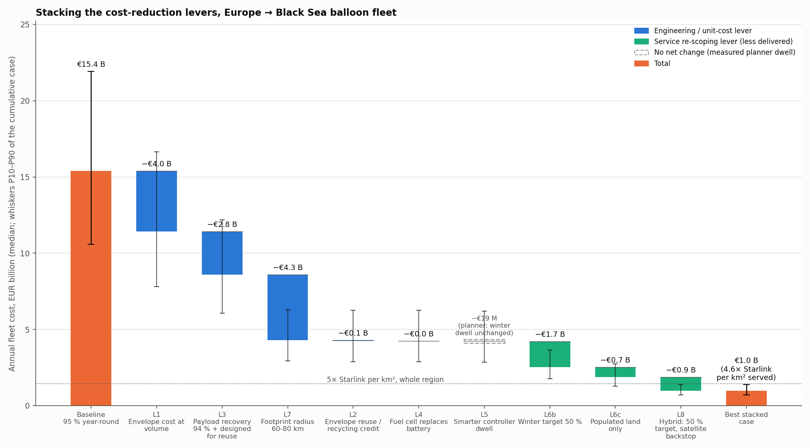

# Balloon fleet — cost-reduction levers

*Generated by `cost_reduction.py` on top of `cost_model.py` (same inputs, 20,000 Monte Carlo draws, bootstrap over the 120 simulated "slow" flights). Median (P10 – P90). Lever 5 dwell: **planner dwell, measured per month (×0.99 on the cost metric; ×1.22 per-flight)**. EUR/km² is per km² of *served* area and time, so partial-service cases are normalised to what they deliver; a lower coverage target is not normalised (as in `cost_model.py`).*

## Verdict

Baseline: **€15.4 B (€10.6 B – €21.9 B)/yr**, 53× (35–81×) Starlink per km². Every engineering lever stacked (cheap envelopes, 94 % payload recovery, 70 km footprint, envelope reuse, fuel cell, lever-5 dwell) but the *same* 95 % year-round service: **€4.2 B (€2.9 B – €6.2 B)/yr, 15× (9–24×) Starlink**. Re-scoping the service as well (50 % target in winter, fleet concentrated on populated land): **€1.9 B (€1.3 B – €2.7 B)/yr, 8.9× (5.6–14.3×)**. Going to a 50 % availability target all year with a satellite backstop: **€975 M (€698 M – €1.4 B)/yr, 4.6× (3.0–7.2×)**.

**No combination that keeps the 95 % year-round service gets within 5× of Starlink; only the hybrid case (50 % availability, satellite backstop, populated land, winter at 50 %) does, and it delivers a materially thinner service.** Honest reading: the balloons can be made roughly an order of magnitude cheaper, but what then competes with Starlink per km² is not the same product (nor is Starlink: it serves dishes, not phones).

**The smarter controller does not move the cost.** The 36 h look-ahead planner (`results/drift_2025_plan.csv`, same 120 launches) raises the per-flight harmonic-mean dwell by ×1.22, but launches/day are set by each month's *mean* dwell (Little's law), and on that metric — the day-weighted harmonic of monthly means that `cost_model.py` uses — the planner is ×0.99: winter (Dec–Mar) dwell is unchanged (2.2 d) and winter is where the launches go; the gain is in July–August, when launches are already few. Its radio recovery also dipped to 74% (vs 78%). Lever 5 therefore contributes ~nothing in the stacks below. For reference, if a flat ×1.22 held in every month the engineering stack would be €3.5 B (€2.4 B – €5.1 B)/yr (12× (7–20×)) and the full stack €823 M (€592 M – €1.2 B)/yr (3.9× (2.6–6.0×)); a flat ×2 would give €2.2 B (€1.5 B – €3.2 B) and €543 M (€400 M – €748 M). Only a controller that lengthens *winter* flights changes the answer.

The physics does not change: cost ≈ balloons aloft ÷ dwell × cost per flight. The levers that matter are the ones that touch the two big multipliers (cost per flight, and balloons needed per unit of useful coverage); recycling credits and hydrogen tweaks are noise.

## Levers one at a time

Each lever alone, all other inputs as in `cost_model.py`. "Delivered" flags what is given up.

| Case | Annual cost | vs baseline | Launches/day | EUR/km²/yr served | × Starlink per km² | Delivered |
|---|---|---|---|---|---|---|
| Baseline (95 %, year-round, whole region) | €15.4 B (€10.6 B – €21.9 B) | -0 % | 1,102 (867 – 1,377) | €1,416 (€974 – €2,017) | 53× (35–81×) | same as baseline |
| L6a Summer-only service (Jun-Aug, 95 %) | €1.7 B (€1.1 B – €2.6 B) | -89 % | 114 (83 – 160) | €627 (€419 – €948) | 24× (15–38×) | 25% of the year, capacity/km² ×0.25 |
| L8 Hybrid: 50 % target, satellite backstop | €4.6 B (€3.3 B – €6.2 B) | -70 % | 322 (277 – 377) | €424 (€304 – €575) | 16× (11–23×) | capacity/km² ×0.29 |
| L7 Footprint radius 60-80 km (higher-gain antennas) | €7.5 B (€5.1 B – €10.9 B) | -51 % | 455 (353 – 580) | €690 (€466 – €1,007) | 26× (16–41×) | capacity/km² ×0.41 |
| L6b Winter target 50 % (Dec-Mar), 95 % otherwise | €9.3 B (€6.5 B – €13.0 B) | -40 % | 661 (539 – 804) | €855 (€598 – €1,193) | 32× (21–48×) | capacity/km² ×0.77 |
| L6c Populated land only (targeted drift) | €11.3 B (€7.6 B – €16.4 B) | -27 % | 807 (617 – 1,038) | €1,418 (€976 – €2,019) | 53× (35–81×) | 74% of the area |
| L1 Envelope cost at volume (learning curve) | €11.4 B (€7.8 B – €16.6 B) | -26 % | 1,102 (867 – 1,377) | €1,050 (€717 – €1,531) | 40× (24–64×) | same as baseline |
| L3 Payload recovery 94 % + designed for reuse | €12.5 B (€8.6 B – €17.8 B) | -19 % | 1,102 (867 – 1,377) | €1,151 (€792 – €1,639) | 43× (29–65×) | same as baseline |
| L2 Envelope reuse / recycling credit (66 % land on land) | €15.1 B (€10.3 B – €21.5 B) | -2 % | 1,102 (867 – 1,377) | €1,384 (€950 – €1,975) | 52× (34–80×) | same as baseline |
| L4 Fuel cell replaces battery (lighter, smaller envelope) | €15.3 B (€10.5 B – €21.8 B) | -1 % | 1,102 (867 – 1,377) | €1,404 (€966 – €2,001) | 53× (34–81×) | same as baseline |
| L5 Smarter controller dwell (planner dwell, measured per month (×0.99 on the cost metric; ×1.22 per-flight)) | €15.9 B (€10.9 B – €22.7 B) | +3 % | 1,095 (866 – 1,361) | €1,466 (€1,006 – €2,084) | 55× (36–84×) | same as baseline |

### Dwell multiplier sweep (lever 5 alone)

| Dwell × | Annual cost | vs baseline | Launches/day | × Starlink |
|---|---|---|---|---|
| planner, per-month (measured) | €15.9 B (€10.9 B – €22.7 B) | +3 % | 1,095 (866 – 1,361) | 55× (36–84×) |
| flat ×1.22 | €12.6 B (€8.7 B – €18.0 B) | -18 % | 903 (711 – 1,128) | 44× (29–67×) |
| flat ×1.5 | €10.3 B (€7.1 B – €14.7 B) | -33 % | 735 (578 – 918) | 36× (23–54×) |
| flat ×2 | €7.7 B (€5.3 B – €11.0 B) | -50 % | 551 (434 – 688) | 27× (18–41×) |

Fixed costs are small, so cost falls almost exactly as 1/(monthly mean dwell). A flat doubling (3.7 → 7.4 d harmonic) would be worth about as much as every unit-cost lever combined — but the measured planner shows the gain where it is cheap to get (summer) and none where it would pay (winter). A controller that stretches *winter* flights is the result to chase.

## Stacked cases

| Case | Annual cost | vs baseline | Launches/day | EUR/km²/yr served | × Starlink per km² | Delivered |
|---|---|---|---|---|---|---|
| Engineering only (same 95 % year-round service) | €4.2 B (€2.9 B – €6.2 B) | -73 % | 453 (352 – 573) | €387 (€264 – €569) | 15× (9–24×) | capacity/km² ×0.41 |
| Engineering + winter 50 % + populated land | €1.9 B (€1.3 B – €2.7 B) | -88 % | 197 (154 – 250) | €235 (€164 – €338) | 8.9× (5.6–14.3×) | 74% of the area, capacity/km² ×0.32 |
| Everything incl. hybrid 50 % target | €975 M (€698 M – €1.4 B) | -94 % | 97 (79 – 120) | €123 (€89 – €171) | 4.6× (3.0–7.2×) | 74% of the area, capacity/km² ×0.12 |

### Stacks under different dwell multipliers

| Dwell × | Engineering only (95 % year-round) | × Starlink | Everything incl. hybrid | × Starlink |
|---|---|---|---|---|
| planner, per-month (measured) | €4.2 B (€2.9 B – €6.2 B) | 15× (9–24×) | €975 M (€698 M – €1.4 B) | 4.6× (3.0–7.2×) |
| flat ×1.22 | €3.5 B (€2.4 B – €5.1 B) | 12× (7–20×) | €823 M (€592 M – €1.2 B) | 3.9× (2.6–6.0×) |
| flat ×1.5 | €2.9 B (€2.0 B – €4.2 B) | 9.9× (6.1–16.3×) | €689 M (€500 M – €961 M) | 3.3× (2.2–5.0×) |
| flat ×2 | €2.2 B (€1.5 B – €3.2 B) | 7.5× (4.6–12.4×) | €543 M (€400 M – €748 M) | 2.6× (1.7–3.9×) |

### Waterfall steps (cumulative, in the order drawn)

| Step | Cumulative annual cost | Step saving (median) |
|---|---|---|
| Baseline (95 %, year-round) | €15.4 B (€10.6 B – €21.9 B) |  |
| Envelope cost at volume (learning curve) | €11.4 B (€7.8 B – €16.6 B) | −€4.0 B |
| Payload recovery 94 % + designed for reuse | €8.6 B (€6.1 B – €12.2 B) | −€2.8 B |
| Footprint radius 60-80 km (higher-gain antennas) | €4.3 B (€2.9 B – €6.3 B) | −€4.3 B |
| Envelope reuse / recycling credit (66 % land on land) | €4.2 B (€2.9 B – €6.3 B) | −€53 M |
| Fuel cell replaces battery (lighter, smaller envelope) | €4.2 B (€2.9 B – €6.2 B) | ≈ 0 |
| Smarter controller dwell (planner dwell, measured per month (×0.99 on the cost metric; ×1.22 per-flight)) | €4.2 B (€2.9 B – €6.2 B) | −€19 M |
| Winter target 50 % (Dec-Mar), 95 % otherwise | €2.5 B (€1.8 B – €3.7 B) | −€1.7 B |
| Populated land only (targeted drift) | €1.9 B (€1.3 B – €2.7 B) | −€668 M |
| Hybrid: 50 % target, satellite backstop | €975 M (€698 M – €1.4 B) | −€894 M |

## Which levers matter

Ranked by median saving when applied alone:

* **L6a Summer-only service (Jun-Aug, 95 %)** — 89 % (€1.7 B (€1.1 B – €2.6 B)/yr). Large absolute saving, but it is 25 % of a service; per km²-year served it is the cheapest form of the fleet because summer dwell is 9 days.
* **L8 Hybrid: 50 % target, satellite backstop** — 70 % (€4.6 B (€3.3 B – €6.2 B)/yr). Random placement at a 50 % target needs 4× fewer balloons than at 95 %; the gaps go to a satellite layer that already exists.
* **L7 Footprint radius 60-80 km (higher-gain antennas)** — 51 % (€7.5 B (€5.1 B – €10.9 B)/yr). Fewer balloons per km² (∝ 1/r²), at the cost of capacity per km² and a dearer payload.
* **L6b Winter target 50 % (Dec-Mar), 95 % otherwise** — 40 % (€9.3 B (€6.5 B – €13.0 B)/yr). Winter is where the launches go; halving the winter target saves more than it looks.
* **L6c Populated land only (targeted drift)** — 27 % (€11.3 B (€7.6 B – €16.4 B)/yr). Depends on being able to keep balloons over people, which random drift does not allow.
* **L1 Envelope cost at volume (learning curve)** — 26 % (€11.4 B (€7.8 B – €16.6 B)/yr). Biggest unit-cost lever: envelopes are a third of spend and single-use.
* **L3 Payload recovery 94 % + designed for reuse** — 19 % (€12.5 B (€8.6 B – €17.8 B)/yr). Second unit-cost lever: cuts the amortised payload line roughly in half.
* **L2 Envelope reuse / recycling credit (66 % land on land)** — 2 % (€15.1 B (€10.3 B – €21.5 B)/yr). Negligible: scrap value is tens of euros; reuse is speculative.
* **L4 Fuel cell replaces battery (lighter, smaller envelope)** — 1 % (€15.3 B (€10.5 B – €21.8 B)/yr). Marginal: lift-gas burn and fuel-cell cost eat most of the saving.
* **L5 Smarter controller dwell (planner dwell, measured per month (×0.99 on the cost metric; ×1.22 per-flight))** — -3 % (€15.9 B (€10.9 B – €22.7 B)/yr). Cost scales with 1/(monthly mean dwell); the measured planner leaves winter dwell unchanged, so it buys nothing here despite a ×1.22 per-flight harmonic mean.

Two things are notable by their absence. Envelope reuse plus the recycling credit (L2) is worth ~€705 per flight against ~€12k of envelope — 68.5 kg of scrap film is worth tens of euros, and reusing a superpressure envelope after a parachute landing is speculative. And the fuel cell (L4) saves a few percent of envelope at best, because the lift gas it burns gives back about a third of the mass saved and the stack costs about what the battery did.

## Assumptions (all flagged)

* Region land fraction 65% (global_land_mask over 36–62°N, 10°W–42°E); envelopes landing on land 66% (scenario A of `analyze_envelopes.py`, 120 slow flights).
* Populated share of land 45%–75% (mode 60%) — **ASSUMPTION**, no population raster in the repo; a GHSL/GPW cut at ~10 people/km² would pin this down.
* Targeting efficiency 20%–70% (mode 40%) — **ASSUMPTION**: how much of the fleet can be kept off sea and empty land by launch-site choice and steering. Drifting balloons cannot be confined to populated cells; the smarter controller's tracks should replace this.
* **L1** Envelope €2.5–7k (mode €4k) vs €4–25k (mode €10k): Wright-law learning 80–90 %/doubling over ~8 doublings from Loon-scale volume to 400k/yr (Nagy et al. 2013 for the learning-rate band; its applicability to balloon film is an ASSUMPTION), floored by film material €0.7–2k (68.5 kg at €10–30/kg, ASSUMPTION).
* **L2** Collected 50–90 % of land landings; 0–40 % (mode 15 %) refurbishable at 20–50 % of new cost; PE scrap €0.1–0.4/kg. All ASSUMPTION; Loon never reflew an envelope.
* **L3** Recovery 0.939 from results/glider_sizing.csv (L/D 12, 2 m/s sink, 28.8 kg/m²); intact 0.85–0.98 (mode 0.93, faster landing); life 10–40 flights (mode 20); refurb 5–15 % (mode 8 %). Intact/life/refurb are ASSUMPTION.
* **L4** Net lifted-mass saving 4–10 kg (15 kg battery → ~5 kg stack, minus ~1 kg/day of lift lost to H₂ burnt at ~100 W night load, 50 % efficiency); envelope mass ∝ (lifted mass)^(2/3) and cost ∝ mass; payload −€2k to +€3k net. All ASSUMPTION.
* **L5** Default: measured per-month dwell of the 36 h look-ahead planner (planner.py, results/drift_2025_plan.csv, same 120 launches/seeds as "slow"), with its 74 % radio recovery; bootstrapped like the baseline. `--dwell-mult X` substitutes a flat multiplier on the slow controller's months (the sweep uses 1.22, 1.5, 2.0).
* **L6a** Service Jun–Aug only at the 95 % target; fixed costs (sites, NOC, regulatory) still paid for the whole year.
* **L6b** Target 50 % Dec–Mar, 95 % otherwise (random-placement coverage formula as in cost_model.py).
* **L6c** Served area = populated land (land fraction × populated share) with the targeting efficiency above; gateways scale with served area.
* **L7** Footprint radius 60–80 km (mode 70) vs 40–50 km; payload cost ×1.1–1.6 for a multi-beam antenna; capacity per balloon unchanged. Minimum elevation 14–18° at the edge, marginal for handset uplink (ASSUMPTION that the link closes).
* **L8** Coverage target 50 % every month; the backstop layer (direct-to-cell satellite or terrestrial) is assumed to exist and is not priced.

## Notes on `cost_model.py`

* **Payload amortisation formula.** `consumed = (1 − rec) + rec / max_flights` retires a fraction `rec/N` of payloads every flight, but only payloads that survive all N flights are retired; the expected flights per payload is geometric, `(1 − rec^N)/(1 − rec)`. With the base inputs the current formula overstates payload consumption by ~17 % and the total by ~6 % (€14.5 B (€10.0 B – €20.7 B)/yr with the geometric form). Conservative, not verdict-changing; this file keeps the original formula so the baseline matches.
* **Envelope recovery cost is charged on every flight** (`per_yr * env_recovery`) although the report says sea landings (34 %) are largely unrecoverable; small (3 % line item).
* **Payload pickup cost** uses `rec_frac × intact` but a field team is dispatched for every glider that reaches a site, intact or not (`rec_frac`); negligible.
* **Lift gas**: `LIFT_GAS_MOL` is BLE's helium fill. The same mol count of H₂ gives ~7 % more net lift (molar mass 2 vs 4), so slightly less gas would do; hydrogen is 0.3 % of cost so it does not matter.
* `per_yr = per_day × 365` while `SEC_PER_YR` uses 365.25; cosmetic.
* The structure is sound for this purpose: `main()` is guarded, every input is a named triangular spec, and `balloon_model` is vectorised, so this file imports it unchanged.

## Lever 5 settings

By default lever 5 uses the planner's measured per-month dwell from `results/drift_2025_plan.csv` (and its radio-recovery rate). Run `--dwell-mult X` or set `DWELL_MULT` to apply a flat multiplier to every month's dwell instead (a flat multiplier is generous, because it lengthens winter flights, which the planner did not manage). If the planner CSV is absent the script falls back to a ×1.0 placeholder and says so.
