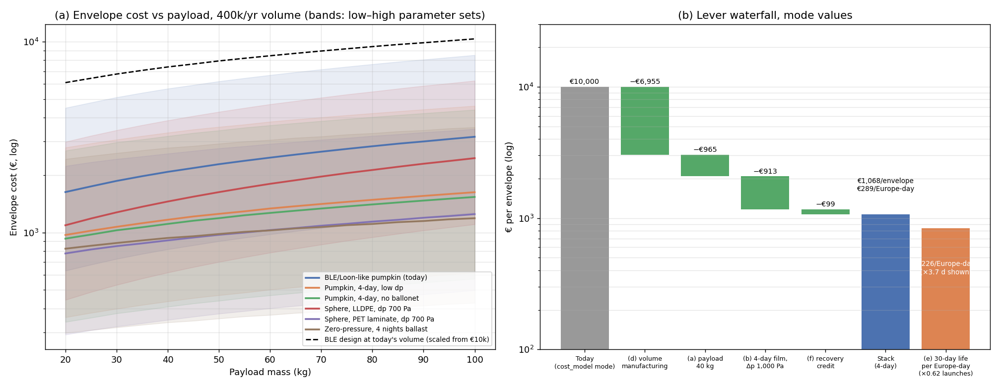

# Envelope cost: physics-based mass model and bottom-up cost

*Generated by `envelope_cost.py`. EUR 2025-26. Ranges are (low–high) over the low/mode/high parameter sets; the central value is the mode set. All non-physics inputs are tagged ASSUMPTION or SOURCE in the script.*

## 1. Mass model and calibration

Lift balance at the design ceiling 60 hPa, 215 K, hydrogen: ρ_air = 0.0972 kg/m³, ρ_H₂ = 0.0095 kg/m³, net 0.0878 kg/m³ (vs helium 0.0785).
The BLE balloon (1,804 m³, 6,830 mol gas, 68.5 + 92.5 kg) only closes at a ceiling of about 60 hPa with 5 % spare lift: 6,830 mol at 60 hPa/215 K occupy 2,035 m³. At 50 hPa the same volume lifts 136 kg net, less than the 161 kg system, so the BLE float band "50–140 hPa" is reached by pumping air in (lower) and only approaches 50 hPa with a lighter system. The model therefore sizes for a 60 hPa ceiling (**ASSUMPTION**, the single most important sizing choice; a 80 hPa ceiling gives a 25 % smaller envelope).

**Calibration to BLE (92.5 kg payload, Δp_max 2,380 Pa):**

| Film gauge | Film | Ballonet | Tendons | Fittings | Envelope | Volume | Gores | Film stress |
|---|---|---|---|---|---|---|---|---|
| 58.7 µm (2.31 mil), calibrated | 47.1 kg | 5.4 kg | 12.2 kg | 3.7 kg | **68.5 kg** | 1,926 m³ | 110 | 11.2 MPa (allow 11.2) |
| 63.5 µm (2.5 mil) | 52.1 kg | 5.6 kg | 12.6 kg | 3.6 kg | **73.9 kg** | 1,990 m³ | 103 | 11.2 MPa (allow 11.2) |
| 76.2 µm (3 mil, reported) | 66.4 kg | 5.9 kg | 13.8 kg | 3.3 kg | **89.4 kg** | 2,175 m³ | 89 | 11.2 MPa (allow 11.2) |
| 58.7 µm, helium | 52.5 kg | 6.1 kg | 14.4 kg | 3.8 kg | **76.8 kg** | 2,265 m³ | 116 | 11.2 MPa (allow 11.2) |

How it was calibrated: the only free knob is the film gauge, solved by bisection so that the BLE design (Δp_max 2,380 Pa, SF 2.5 on cold yield 28 MPa for a 100+ day creep life, tendons at SF 2.0 on the 2,380 Pa limit) gives exactly 68.5 kg at 92.5 kg payload: 58.7 µm (2.31 mil). With the reported "3 mil" Loon film the same model gives 89 kg and 2.5 mil gives 74 kg, so the reported gauge over-predicts BLE's mass by 10–30 %, which is the honest accuracy of the model. The volume comes out at 1,926 m³ vs BLE's 1,804 (+7 %, the 5 % lift margin). Other fixed choices: 2,380 Pa limit, a 1.10 pumpkin area factor, a 15 µm ballonet of 0.35 V, and 1.5 kg + 20 g/gore of fittings. The split (film 69 %, tendons 18 %, ballonet 8 %, fittings 5 %) is a modelling result, not a Loon datum. The "3 mil" figure is a secondary source and BLE's 1,804 m³ is ~1.5× the volume implied by stratocat's 15 m × 9 m float dimensions, so a 10–30 % gap is within the data.

Pumpkin film stress: σ = Δp·r_lobe/t with r_lobe = 0.28 m (110 gores of 0.44 m); the film carries only the lobe hoop load, the tendons carry Δp·πR² = 445 kN. A plain sphere of the same volume at 2,380 Pa would need t = Δp·R/(2σ) = 820 µm of LLDPE, i.e. infeasible (film mass per m³ exceeds the net lift): a sphere's film mass per m³ is 3Δp·ρ/(2σ), independent of size, so an LLDPE sphere only works at low Δp or with a much stronger film.

### Envelope mass vs payload mass (kg envelope, 60 hPa ceiling, hydrogen)

| Payload | BLE/Loon-like pumpkin (today) | Pumpkin, 4-day, low dp | Pumpkin, 4-day, no ballonet | Sphere, LLDPE, dp 700 Pa | Sphere, PET laminate, dp 700 Pa | Zero-pressure, 4 nights ballast |
|---|---|---|---|---|---|---|
| 20 kg | 31.5 (616 m³) | 11.5 (370 m³) | 9.3 (344 m³) | 50.1 (821 m³) | 14.1 (400 m³) | 9.5 (539 m³, +14 kg ballast) |
| 30 kg | 37.9 (812 m³) | 14.0 (517 m³) | 11.3 (486 m³) | 70.4 (1,176 m³) | 19.2 (576 m³) | 11.3 (734 m³, +19 kg ballast) |
| 40 kg | 43.6 (1,000 m³) | 16.3 (661 m³) | 13.1 (624 m³) | 90.5 (1,528 m³) | 24.1 (751 m³) | 12.9 (926 m³, +24 kg ballast) |
| 55 kg | 51.4 (1,273 m³) | 19.3 (873 m³) | 15.6 (830 m³) | 120.2 (2,052 m³) | 31.5 (1,012 m³) | 15.1 (1,212 m³, +31 kg ballast) |
| 70 kg | 58.6 (1,538 m³) | 22.1 (1,083 m³) | 17.9 (1,033 m³) | 149.8 (2,573 m³) | 38.7 (1,273 m³) | 17.1 (1,494 m³, +39 kg ballast) |
| 90 kg | 67.4 (1,883 m³) | 25.6 (1,359 m³) | 20.7 (1,301 m³) | 188.8 (3,265 m³) | 48.3 (1,620 m³) | 19.6 (1,868 m³, +48 kg ballast) |
| 100 kg | 71.7 (2,054 m³) | 27.2 (1,496 m³) | 22.0 (1,435 m³) | 208.3 (3,610 m³) | 53.1 (1,792 m³) | 20.8 (2,054 m³, +53 kg ballast) |

At 40 kg payload: BLE/Loon-like pumpkin (today): 43.6 kg, 564 m² film at 59 µm, 89 gores, 3642 m of seams; Pumpkin, 4-day, low dp: 16.3 kg, 428 m² film at 25 µm, 46 gores, 1640 m of seams; Pumpkin, 4-day, no ballonet: 13.1 kg, 412 m² film at 25 µm, 45 gores, 1574 m of seams; Sphere, LLDPE, dp 700 Pa: 90.5 kg, 680 m² film at 134 µm, 25 gores, 561 m of seams; Sphere, PET laminate, dp 700 Pa: 24.1 kg, 423 m² film at 49 µm, 20 gores, 354 m of seams; Zero-pressure, 4 nights ballast: 12.9 kg, 575 m² film at 20 µm, 22 gores, 919 m of seams.

Notes: the 4-day pumpkin uses Δp 1,000 Pa (enough for a ~20 K supertemperature at 60 hPa plus control margin), film at the 25 µm handling floor with SF 1.5, tendons SF 1.5. Removing the ballonet (no altitude control) saves ~2–3 kg but the drift study shows passive balloons dwell 3.2 d instead of 5.4 d (×1.69 launches), which costs far more than the film. The LLDPE sphere at 700 Pa is stress-limited to 134 µm film and is heavier than the pumpkin; a PET-laminate sphere (GHOST-balloon heritage, 100 MPa film, SF 2.5) is the lightest pressurised option but PET at −70 °C is crease- and pinhole-sensitive, is not heat-sealable (needs adhesive tape seams) and has no modern long-duration track record: an R&D option, not a baseline. The zero-pressure balloon is the lightest envelope but needs ~7.5 % of gross mass in ballast per night (5–10 %): 4 nights at 45–55°N costs 24 kg of ballast on a 40 kg payload, and the balloon has no altitude steering (vent/ballast only), so launches ×1.69. Beyond ~8–10 nights a ZP balloon cannot carry its own ballast.

Zero-pressure endurance at 45–55°N (ballast = fraction b of gross per night; gross grows as 1/(1 − N·b)):

| Ballast/night | 2 nights | 4 nights | 6 nights | 8 nights | 10 nights |
|---|---|---|---|---|---|
| 5.0 % | env 11 kg + ballast 6 kg, 696 m³ | env 12 kg + ballast 14 kg, 795 m³ | env 13 kg + ballast 24 kg, 926 m³ | env 14 kg + ballast 38 kg, 1,108 m³ | env 16 kg + ballast 59 kg, 1,376 m³ |
| 7.5 % | env 11 kg + ballast 10 kg, 742 m³ | env 13 kg + ballast 24 kg, 926 m³ | env 15 kg + ballast 48 kg, 1,228 m³ | env 19 kg + ballast 93 kg, 1,806 m³ | env 28 kg + ballast 214 kg, 3,316 m³ |
| 10.0 % | env 12 kg + ballast 14 kg, 795 m³ | env 14 kg + ballast 38 kg, 1,108 m³ | env 19 kg + ballast 93 kg, 1,806 m³ | env 35 kg + ballast 312 kg, 4,528 m³ | impossible |

## 2. Bottom-up cost per envelope

Today = Loon/Aerostar-era volume (~10³/yr, manual table assembly). Volume = ~400k/yr dedicated line (blown-film line, automated gore cutting, continuous sealing, inline leak/pinhole inspection).

| Line | Today, BLE design 92.5 kg | Volume, BLE design 92.5 kg | Volume, 4-day pumpkin, 40 kg |
|---|---|---|---|
| film | €707 (€377–€1,414) | €236 (€141–€424) | €49 (€30–€89) |
| ballonet | €136 (€82–€272) | €54 (€33–€98) | €27 (€16–€48) |
| tendon | €1,833 (€978–€3,667) | €733 (€367–€1,467) | €79 (€40–€159) |
| fittings | €1,860 (€930–€3,820) | €365 (€135–€890) | €269 (€103–€634) |
| seams | €3,361 (€1,680–€6,721) | €560 (€224–€1,400) | €164 (€66–€410) |
| labour | €2,471 (€961–€6,590) | €255 (€82–€796) | €166 (€56–€502) |
| qa | €800 (€300–€2,000) | €70 (€30–€200) | €70 (€30–€200) |
| packaging | €150 (€80–€300) | €30 (€15–€60) | €30 (€15–€60) |
| scrap | €1,698 (€431–€6,196) | €184 (€41–€800) | €68 (€14–€315) |
| capex | €300 (€100–€800) | €50 (€20–€150) | €50 (€20–€150) |
| margin | €3,995 (€1,184–€14,301) | €507 (€131–€1,886) | €194 (€47–€770) |
| total | €17,311 (€7,103–€46,081) | €3,045 (€1,219–€8,171) | €1,167 (€435–€3,337) |

The bottom-up "today" figure €17,311 (€7,103–€46,081) is somewhat above cost_model.py's tri(€4k, €10k, €25k) at the mode but the ranges overlap, so the two agree on where we are to within the uncertainty of hand-built balloon pricing. Cost per kg: today 253 €/kg, volume BLE design 44 €/kg, volume 4-day design 72 €/kg (a latex weather balloon retails at ~€50–100/kg).

Learning-curve cross-check (Wright's law on the non-material part of today's cost, from a cumulative ~5,000 Loon-era envelopes to 400k/yr):

| Learning rate | Cumulative 400k | Cumulative 2 M (5 yr) |
|---|---|---|
| 80 % | €4,641 | €3,197 |
| 85 % | €6,309 | €4,662 |
| 90 % | €8,589 | €6,957 |

(material taken at 40 % of today's unit price at volume). The bottom-up volume estimate for the same design, €3,045 (€1,219–€8,171), sits inside the 80–90 % band, so the two methods are consistent; cost_reduction.py's L1 band (€2.5–7k, mode €4k) is the conservative end.

Sources and anchors: NASA SPB 38 µm coextruded LLDPE + PBO tendons (NTRS 20180007750, ICRC 2005); Raven StratoFilm-430 10–20 µm three-layer LLDPE (Raven 2002); Loon film "3 mil" PE by Raven Aerostar (secondary); Aerostar 2023 deck "HAB cost per asset ~$50–500k", tactical PE balloons "a few thousand dollars"; World View "hundreds of thousands vs $2–3 M for NASA" ZP missions (MIT Tech Review 2017); LLDPE Europe €0.8–2.1/kg and mLLDPE ~$2.0–2.4/kg in 2026 (Procurement Resource, Polymerupdate, BusinessAnalytiq); 1.2 kg latex weather balloon $129 retail (High Altitude Science). Everything per line in the cost table (seam €/m, labour hours, QA, scrap, capex, margin, tendon €/kg, fittings) is ASSUMPTION.

## 3. Levers

Each lever alone. Rows (a), (b), (d) are ratios from the bottom-up model applied to today's €10,000 mode (reference €10,000); rows (c), (f), (g) are absolute bottom-up volume costs for a 40 kg payload, referenced to the 4-day pumpkin at volume (€1,167). €/Europe-day = cost × launch multiplier ÷ 3.7 d; designs without altitude control (no ballonet, zero-pressure) carry ×1.69 launches.

| Lever | Envelope cost | vs reference | Launches × | €/Europe-day |
|---|---|---|---|---|
| (a) payload 55 kg, same design, today's volume | €8,191 (€8,112–€8,253) | -18 % | 1.00 | €2,214 |
| (a) payload 40 kg, same design, today's volume | €7,377 (€7,264–€7,465) | -26 % | 1.00 | €1,994 |
| (a) payload 30 kg, same design, today's volume | €6,771 (€6,634–€6,879) | -32 % | 1.00 | €1,830 |
| (b) 4-day film (25 µm, SF 1.5) + Δp 1,000 Pa, 92.5 kg, today's volume | €6,321 (€6,056–€6,569) | -37 % | 1.00 | €1,708 |
| (b′) NASA-gauge 38 µm film only (Δp and SF unchanged), 92.5 kg | €10,912 (€10,796–€10,957) | +9 % | 1.00 | €2,949 |
| (c) Pumpkin, 4-day, no ballonet vs 4-day pumpkin, 40 kg, volume | €1,109 (€408–€3,201) | -5 % | 1.69 | €506 |
| (c) Sphere, LLDPE, dp 700 Pa vs 4-day pumpkin, 40 kg, volume | €1,453 (€617–€3,868) | +25 % | 1.00 | €393 |
| (c) Sphere, PET laminate, dp 700 Pa vs 4-day pumpkin, 40 kg, volume | €909 (€348–€2,592) | -22 % | 1.00 | €246 |
| (c) Zero-pressure, 4 nights ballast vs 4-day pumpkin, 40 kg, volume | €936 (€338–€2,780) | -20 % | 1.69 | €427 |
| (d) 400k/yr automated line, BLE design 92.5 kg | €3,045 (€1,219–€8,171) | -70 % | 1.00 | €823 |
| (f) recovery credit (refly/resin/fittings) on the 4-day 40 kg volume envelope | €1,068 (€428–€2,599) | -8 % | 1.00 | €289 |
| (g) ceiling 80 hPa instead of 60 (smaller volume), 4-day 40 kg, volume | €1,040 (€386–€2,982) | -11 % | 1.00 | €281 |
| (g) 40 µm film, fewer/wider gores (standard 1.8 m roll), 4-day 40 kg, volume | €1,140 (€437–€3,215) | -2 % | 1.00 | €308 |

(f) detail: 66% land × 70% collected = 46% of envelopes come back; refly probability 10% after a €80 inspection, resin €0.25/kg, 60% of fittings reusable: credit €99 (€7–€738) per envelope, i.e. 8 % of a €1,167 envelope. The 16 kg of resin is worth ~€4; what the return scheme really buys is the fittings and litter avoidance, and cost_model.py already charges €100–1,500 per envelope for pickup, more than any credit here. Pay the gig pickup for debris reasons; do not count on it for money.

### Stacked (per envelope, per flight)

| Step | Envelope €/flight | €/Europe-day (÷3.7 d) |
|---|---|---|
| Today: cost_model mode, BLE design, 92.5 kg | €10,000 (€4,000–€25,000) | €2,703 (€1,081–€6,757) |
| + (d) 400k/yr automated manufacturing | €3,045 (€1,219–€8,171) | €823 (€329–€2,208) |
| + (a) payload 40 kg (30–55) | €2,080 (€727–€6,445) | €562 (€197–€1,742) |
| + (b) 4-day film/SF and Δp 1,000 Pa | €1,167 (€398–€3,683) | €315 (€108–€995) |
| + (f) recovery credit | €1,068 (€391–€2,879) | €289 (€106–€778) |
| + (g) ceiling 80 hPa (optional, needs re-simulation) | €948 (€351–€2,541) | €256 (€95–€687) |

Best realistic stack (without the 80 hPa option): **€1,068 (€391–€2,879) per envelope, €289 (€106–€778) per Europe-day**, against €10,000 and €2,700 today: a ×9 reduction (×3–×26). The ballonet is kept: it is the altitude control that the whole dwell result depends on.

Residual cost breakdown of the mode 4-day 40 kg envelope: fittings €269 (23 %), margin €194 (17 %), labour €166 (14 %), seams €164 (14 %), tendon €79 (7 %), qa €70 (6 %), scrap €68 (6 %), capex €50 (4 %), film €49 (4 %), packaging €30 (3 %), ballonet €27 (2 %). 
Film is only 4 %: the residual is dominated by the things that scale with the number of parts and operations — fittings, seams × gores, labour, QA — plus margin and scrap. That is why gore count (lobe radius) and fitting design matter more than film price from here on.

### (e) Designing for envelope life: 4 vs 30/60/100 days, cost per Europe-day

Longer life = higher creep SF on the film, UV/ozone allowance, tendon SF 2.0, tighter QA (×1.5–3) and more scrap (+2–8 pp). Launch multipliers from the multi-pass study: free routing ×0.62/0.49/0.42, China-avoidance without propulsion ×0.77/0.68/0.62. Europe-days per launch = 3.7 ÷ multiplier.

| Design life | Envelope kg (40 kg payload) | Film µm | €/envelope (volume) | €/Europe-day, free routing | €/Europe-day, avoid China |
|---|---|---|---|---|---|
| 4 d | 16.3 | 25 | €1,167 (€435–€3,337) | €315 (€118–€902) | €315 (€118–€902) |
| 30 d | 17.6 | 26 | €1,347 (€505–€3,852) | €226 (€85–€645) | €280 (€105–€802) |
| 60 d | 18.2 | 27 | €1,484 (€556–€4,258) | €197 (€74–€564) | €273 (€102–€783) |
| 100 d | 18.6 | 28 | €1,674 (€628–€4,836) | €190 (€71–€549) | €280 (€105–€810) |

A 100-day envelope costs about ×1.43 a 4-day one but is launched ×0.42 as often, so per Europe-day it is ×0.60 (free routing) or ×0.89 (China avoided). The envelope line therefore favours long-life designs mildly; the real argument for long flights is the payload/launch lines, which also scale with launches, and against it the payload recovery rate (multipass: 60 % recovered at 30 d, 32 % at 100 d) and the ~22 % of time over Russia/C. Asia/China. For the envelope alone, a 30-day design is the sweet spot: €226 (€85–€645) per Europe-day vs €315 (€118–€902) for 4-day.

## 4. Recommendation

* **Target design:** superpressure pumpkin, hydrogen, 60 hPa ceiling, Δp_max ~1,000 Pa (not 2,380), 25–30 µm coextruded mLLDPE film at the handling floor, ~56 gores of ~0.61 m (lobe radius 0.39 m), UHMWPE tendons (~1.8 kg), 15 µm ballonet, moulded polymer end fittings, designed for 30 days (SF 1.9, 5 % UV allowance). Envelope 18 kg for a 40 kg payload (678 m³, 435 m² of film). If the fleet stays one-way (3.7 d), the 4-day variant (16 kg) is marginally cheaper per envelope and the choice is driven by the payload lines, not the envelope.
* **Cost:** €1,347 (€505–€3,852) per envelope at 400k/yr-class volume; €226 (€85–€645) per Europe-day with free routing (€280 (€105–€802) if China must be avoided); the 4-day one-way variant €1,167 (€435–€3,337) per envelope, €315 (€118–€902) per Europe-day. Today's €10k mode is €2,700 per Europe-day.
* **Best realistic stack vs €10k:** volume manufacturing (×0.18) → lighter payload (×0.68) → low-Δp thin-film design (×0.56) → recovery credit (×0.92): €1,068 (€391–€2,879). Roughly ×8 in cost, of which volume is ×3, mass (payload + design) ×2.5, recovery ×0.9. In the fleet model (envelopes 33 % of €38.7k) that is about −€11k per flight at the mode, ~−28 % of the all-in cost before overhead.
* **What dominates the residual:** fittings + per-gore terminations, seam metres (gores × meridian × 2), labour and QA — the "number of parts" costs — then margin and scrap; film resin is <10 %. Reducing gore count (larger lobe radius means thicker film: the trade is 25 µm/many gores vs 40 µm/fewer gores — roughly neutral on cost in this model), moulded one-piece end fittings, and continuous tendon-sleeve sealing are the next engineering targets. Reusing fittings from returned envelopes is worth more than the resin.
* **Biggest uncertainties:** (1) the design ceiling (60 vs 80 hPa changes volume by 25 %, and whether the drift results hold at a lower ceiling needs re-simulation); (2) whether 25–30 µm LLDPE holds 1,000 Pa for 4–30 days without pinhole leaks at 400k units/yr quality (Loon's leak history says QA, folding and handling dominate, not film strength); (3) the cold-film allowable (25–35 MPa band) and creep SF; (4) the supplier margin/capex at 400k/yr, which no balloon maker has ever reached (Aerostar makes ~10³/yr); (5) tendon price; (6) the per-gore fitting and seam costs, which carry most of the residual.
* **Things in `cost_model.py` / `combined_cost.py` that look wrong or inconsistent:** `ENVELOPE_EUR` tri(4k,10k,25k) is a Loon-era low-volume price applied to a 400k/yr fleet (the baseline is internally inconsistent: that volume would itself bring the price down ~×3); `ENVELOPE_KG` is fixed at 68.5 regardless of payload mass, float band or flight life; cost_reduction.py's material floor "€10–30/kg film" is ~×3 too high (resin €1–2.4/kg, converted specialty film €3–9/kg); `combined_cost.py` scales envelope mass ∝ payload (0.74 kg/kg) but film scales ∝ lift^(2/3) and only tendons ∝ lift, so a 40 kg payload with the same film gauge and Δp gives 44 kg (ratio 1.09) not 30 kg — the lighter-hardware saving on the envelope is smaller than combined_cost.py assumes unless the design is changed too; the L2 envelope-reuse credit is estimated as if 15 % of envelopes could be refurbished at 20–50 % of new cost, which for a thin-film consumable is a 0–30 % refly probability minus an inspection cost (net credit a few % of a €1–2k envelope); `ENVELOPE_RECOVERY_EUR` €100–1,500 is charged on sea landings too and will exceed the envelope cost itself once envelopes are ~€1k, so the pickup/reward scheme should be budgeted as a litter-liability line, not against envelope cost; and the BLE float band 50–140 hPa is not reachable by the BLE mass at 50 hPa with hydrogen (see §1).

## Assumption register (beyond the tags in the script)

* Stratosphere 215 K at the ceiling; ceiling 60 hPa; 5 % spare lift.
* LLDPE cold yield 28 MPa (band 25–35), density 920; film floor 25 µm (SP) / 20 µm (ZP); ballonet 15 µm, 0.35 V.
* Pumpkin area ×1.10 vs sphere, natural-shape ZP ×1.18, seams/caps ×1.06, gore width 1.6 × lobe radius, roll width 1.8 m.
* UHMWPE tendon 3.0 GPa, 970 kg/m³, braid/termination efficiency 0.6, SF 1.5–2.0 on Δp_max.
* ZP ballast 5–10 % of gross per night, 3 kg ballast hardware; ZP has no altitude steering → launches ×1.69 (README passive vs slow dwell).
* Cost parameter sets TODAY and VOLUME as listed in the script (film €/kg, tendon €/kg, fittings, seam €/m, labour, QA, packaging, scrap, capex, margin).
* Recovery: 66 % land (measured), 50–90 % collected, 0–30 % refly, inspection €40–150, resin €0.05–0.45/kg, fittings 30–80 % reusable at 70 % value.
* Life design: SF 1.5/1.9/2.2/2.5 and UV allowance 0/5/8/10 % for 4/30/60/100 days; QA ×1/1.5/2/3; scrap +0/2/5/8 pp.
