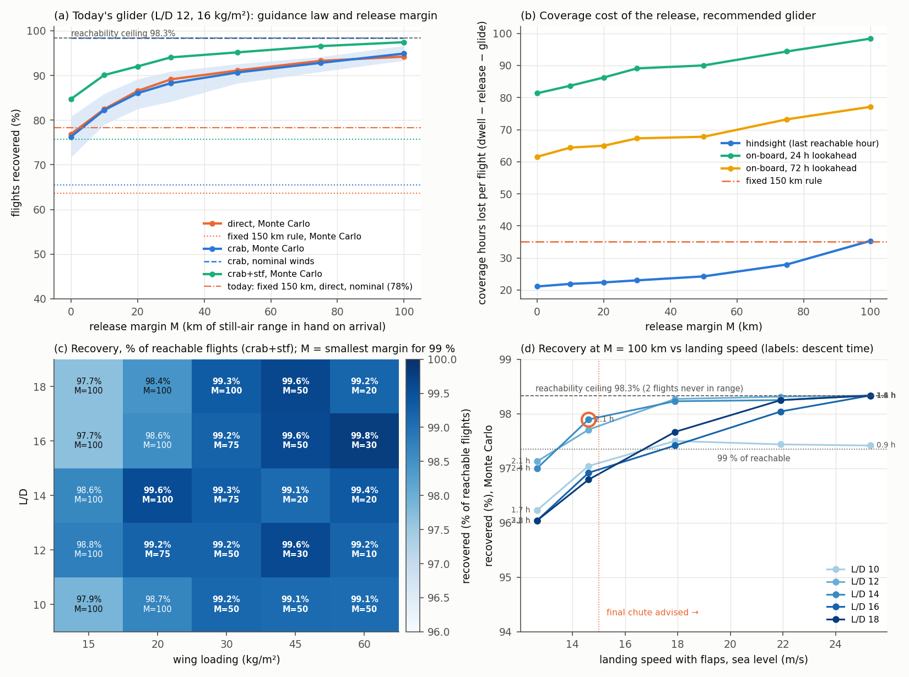

# Radio-return glider tuning

Inputs: 120 slow-controller flights (results/slow_tracks.csv, hourly tracks reproduced from run_drift.py), 27480 candidate (hour, site) glides within 500 km. Monte Carlo per release: wind bias U(0,5) m/s random direction, AR(1) gust noise 1 m/s (15 min), surface taper U(0.1, 1.0) (nominal 0.3); K=40 samples in the sweeps, 100 for the final diagnosis. Recovery = landing within 25 km of the site (as today); "close" = within 5 km.

## Recommendation

- **Guidance**: crab-angle track hold (solve heading so ground velocity points along the great circle to the site; fall back to pointing at the site when the cross wind exceeds airspeed), plus speed-to-fly (fly up to 1.8x best-glide speed into headwinds, parabolic polar), then hold station overhead and spiral down. Crab vs direct pointing is -0.6 points at today's design (within Monte Carlo noise: the losing cases are winds above airspeed, where no heading helps); speed-to-fly is worth +8.4 points and is the part of the guidance that matters.
- **Release policy**: at every hour simulate the glide to every site within 500 km using the forecast winds; release at the last hour at which some site is reachable with arrival margin >= **M = 100 km** (arrival altitude x L/D). This is a hindsight rule; the on-board version (release when nothing is forecast reachable in the next H hours) recovers 98.2% with H=24 h and 98.1% with H=72 h but costs 98 h / 77 h of coverage per flight because reachability often returns days later.
- **Design point**: **L/D 14, wing loading 20 kg/m²** (sea-level sink 1.43 m/s, best-glide TAS 20 m/s at sea level, 75 m/s at 20 km): the best-recovering design that needs no landing chute and recovers >= 99 % of the reachable flights. If a final chute is acceptable, **L/D 18 @ 60 kg/m²** recovers 98.3% (P10–P90 98.3%–98.3%, i.e. every reachable flight in every sample) at M=75 km, descent 1.58 h, coverage lost 20.2 h/flight, landing 25 m/s with flaps.
- **Ceiling**: only 98.3% of flights (118/120) ever pass within glide range (500 km, any design) of one of the 21 sites, so 99 % of all flights is not attainable with this site network; targets below are 99 % of the reachable 118.
- **Achieved**: 98.0% of all 120 flights recovered under the Monte Carlo (P10–P90 across wind-error samples 97.5%–98.3%; nominal winds 98.3%), vs today's fixed-150 km rule with direct pointing: 78.3% nominal, 63.6% under the same Monte Carlo.
- **Coverage cost**: 35.3 h per flight (27.4% of balloon-hours) lost between release and the balloon leaving the region, vs 35.1 h (27.2%) for the fixed-150 km rule; median glide home 177 km, descent (transmit) time 2.11 h.
- **Landing**: 20 m/s at CL 0.8, 15 m/s with full flaps (CL 1.5), 107 J/kg kinetic energy. Belly/flare landing feasible without a chute.

## 1. Guidance law (today's design, L/D 12, 16 kg/m², hindsight release)

| policy | guidance | releases | nominal | MC mean | P10–P90 | within 5 km | lost h/flight | glide home km |
|---|---|---|---|---|---|---|---|---|
| fixed150 | crab | 115 | 79.2% | 65.5% | 61.7%–68.3% | 53.7% | 34.9 | 134 |
| last-0 | crab | 120 | 98.3% | 76.3% | 71.7%–80.8% | 55.0% | 23.7 | 146 |
| last-10 | crab | 120 | 98.3% | 82.3% | 79.0%–85.9% | 65.4% | 24.1 | 145 |
| last-20 | crab | 120 | 98.3% | 86.0% | 82.5%–89.2% | 74.2% | 25.3 | 137 |
| last-30 | crab | 120 | 98.3% | 88.3% | 84.2%–90.9% | 79.3% | 26.2 | 135 |
| last-50 | crab | 120 | 98.3% | 90.7% | 88.2%–92.6% | 85.5% | 30.9 | 116 |
| last-75 | crab | 120 | 98.3% | 92.8% | 90.8%–94.2% | 90.0% | 36.9 | 106 |
| last-100 | crab | 120 | 98.3% | 94.9% | 93.3%–96.7% | 93.3% | 40.5 | 86 |
| fixed150 | crab+stf | 115 | 85.0% | 75.7% | 73.2%–79.2% | 60.5% | 35.2 | 135 |
| last-0 | crab+stf | 120 | 98.3% | 84.7% | 80.8%–88.3% | 59.2% | 23.7 | 147 |
| last-10 | crab+stf | 120 | 98.3% | 90.1% | 86.7%–93.3% | 70.8% | 24.1 | 146 |
| last-20 | crab+stf | 120 | 98.3% | 92.0% | 90.0%–94.2% | 78.7% | 25.3 | 140 |
| last-30 | crab+stf | 120 | 98.3% | 94.0% | 92.5%–95.8% | 85.5% | 26.2 | 136 |
| last-50 | crab+stf | 120 | 98.3% | 95.2% | 94.2%–96.7% | 91.0% | 31.0 | 117 |
| last-75 | crab+stf | 120 | 98.3% | 96.6% | 95.0%–97.5% | 94.4% | 37.0 | 106 |
| last-100 | crab+stf | 120 | 98.3% | 97.4% | 96.6%–98.3% | 96.0% | 40.6 | 86 |
| fixed150 | direct | 115 | 78.3% | 63.6% | 60.0%–65.9% | 49.2% | 34.9 | 136 |
| last-0 | direct | 120 | 98.3% | 76.9% | 72.5%–80.8% | 50.5% | 25.5 | 154 |
| last-10 | direct | 120 | 98.3% | 82.5% | 79.2%–85.1% | 60.0% | 26.0 | 151 |
| last-20 | direct | 120 | 98.3% | 86.5% | 84.2%–90.0% | 69.2% | 27.0 | 136 |
| last-30 | direct | 120 | 98.3% | 89.1% | 87.4%–91.7% | 75.9% | 29.1 | 134 |
| last-50 | direct | 120 | 98.3% | 91.1% | 88.2%–93.3% | 81.8% | 33.2 | 121 |
| last-75 | direct | 120 | 98.3% | 93.3% | 91.6%–95.8% | 87.8% | 39.8 | 107 |
| last-100 | direct | 120 | 98.3% | 94.2% | 92.4%–95.8% | 90.9% | 44.1 | 88 |

At M=0 under the Monte Carlo: direct 76.9%, crab 76.3%, crab + speed-to-fly 84.7%. Crab angle alone is a small gain (the limiting cases are head/cross winds above the glider's airspeed, where no heading helps); speed-to-fly helps the light, slow glider because it trades glide ratio for penetration exactly in those cases. The largest gains come from the release policy (release wherever a site is reachable, not only within 150 km) and from the arrival margin.

## 2–3. Release margin and robustness (recommended design)

| policy | nominal | MC mean | P10–P90 | within 5 km | lost h/flight | lost % | release dist km | glide home km |
|---|---|---|---|---|---|---|---|---|
| causal24-0 | 98.3% | 85.3% | 82.5%–88.3% | 59.2% | 81.3 | 63.1 | 197 | 194 |
| causal24-10 | 98.3% | 90.8% | 88.3%–92.6% | 70.9% | 83.7 | 64.9 | 195 | 192 |
| causal24-20 | 98.3% | 94.8% | 93.3%–96.7% | 81.9% | 86.2 | 66.9 | 184 | 181 |
| causal24-30 | 98.3% | 96.4% | 94.9%–97.5% | 88.5% | 89.1 | 69.1 | 179 | 177 |
| causal24-50 | 98.3% | 97.4% | 95.8%–98.3% | 94.4% | 90.0 | 69.8 | 157 | 154 |
| causal24-75 | 98.3% | 97.6% | 96.7%–98.3% | 96.9% | 94.4 | 73.2 | 137 | 135 |
| causal24-100 | 98.3% | 98.2% | 98.2%–98.3% | 98.0% | 98.4 | 76.3 | 116 | 114 |
| causal72-0 | 98.3% | 84.8% | 81.7%–87.6% | 59.5% | 61.5 | 47.7 | 188 | 185 |
| causal72-10 | 98.3% | 90.4% | 87.5%–93.3% | 71.4% | 64.4 | 49.9 | 181 | 178 |
| causal72-20 | 98.3% | 94.3% | 92.5%–96.7% | 82.7% | 65.0 | 50.4 | 175 | 172 |
| causal72-30 | 98.3% | 96.7% | 95.8%–98.3% | 89.4% | 67.3 | 52.2 | 170 | 168 |
| causal72-50 | 98.3% | 97.6% | 96.7%–98.3% | 94.8% | 67.8 | 52.6 | 155 | 152 |
| causal72-75 | 98.3% | 97.8% | 96.7%–98.3% | 96.9% | 73.2 | 56.8 | 138 | 136 |
| causal72-100 | 98.3% | 98.1% | 97.5%–98.3% | 97.8% | 77.1 | 59.8 | 118 | 116 |
| fixed150 | 92.5% | 87.6% | 85.8%–90.0% | 80.1% | 35.1 | 27.2 | 141 | 137 |
| last-0 | 98.3% | 84.4% | 80.8%–88.3% | 60.4% | 21.1 | 16.4 | 180 | 177 |
| last-10 | 98.3% | 89.7% | 86.7%–92.5% | 71.1% | 21.9 | 17.0 | 175 | 172 |
| last-20 | 98.3% | 93.9% | 92.4%–95.8% | 82.5% | 22.4 | 17.3 | 164 | 161 |
| last-30 | 98.3% | 95.2% | 93.3%–96.7% | 87.8% | 23.0 | 17.8 | 161 | 158 |
| last-50 | 98.3% | 96.2% | 94.9%–97.5% | 92.8% | 24.2 | 18.8 | 150 | 147 |
| last-75 | 98.3% | 96.7% | 95.8%–97.5% | 95.4% | 28.0 | 21.7 | 137 | 134 |
| last-100 | 98.3% | 97.9% | 96.7%–98.3% | 97.3% | 35.3 | 27.4 | 117 | 115 |

## 4. Design sweep (crab+stf guidance; per design the smallest M reaching 99 %, else the best M)

| L/D | W/S kg/m² | sink m/s | M km | MC recovery | P10–P90 | nominal | lost h/flight | descent h | V land / flaps m/s | KE J/kg | chute? | fixed-150 today |
|---|---|---|---|---|---|---|---|---|---|---|---|---|
| 10 | 15 | 1.73 | 100 | **96.2%** | 95.0%–97.5% | 97.5% | 56.3 | 1.74 | 17 / 13 | 80 | no | 70.0% |
| 10 | 20 | 2.00 | 100 | **97.0%** | 95.8%–97.5% | 97.5% | 56.4 | 1.51 | 20 / 15 | 107 | no | 77.5% |
| 10 | 30 | 2.45 | 50 | **97.5%** | 97.4%–97.6% | 97.5% | 39.7 | 1.24 | 25 / 18 | 160 | yes | 87.5% |
| 10 | 45 | 3.00 | 50 | **97.4%** | 96.7%–97.5% | 97.5% | 39.4 | 1.02 | 30 / 22 | 240 | yes | 91.7% |
| 10 | 60 | 3.47 | 50 | **97.4%** | 96.7%–97.5% | 97.5% | 39.3 | 0.89 | 35 / 25 | 320 | yes | 94.2% |
| 12 | 15 | 1.44 | 100 | **97.1%** | 95.8%–98.3% | 98.3% | 40.5 | 2.07 | 17 / 13 | 80 | no | 84.2% |
| 12 | 16.2 | 1.50 | 100 | **97.4%** | 96.6%–98.3% | 98.3% | 40.6 | 2.00 | 18 / 13 | 86 | no | 85.0% |
| 12 | 20 | 1.67 | 75 | **97.6%** | 96.7%–98.3% | 98.3% | 37.8 | 1.80 | 20 / 15 | 107 | no | 89.2% |
| 12 | 30 | 2.04 | 50 | **97.6%** | 96.7%–98.3% | 98.3% | 31.4 | 1.48 | 25 / 18 | 160 | yes | 93.3% |
| 12 | 45 | 2.50 | 30 | **97.9%** | 97.5%–98.3% | 98.3% | 27.7 | 1.22 | 30 / 22 | 240 | yes | 94.2% |
| 12 | 60 | 2.89 | 10 | **97.5%** | 96.7%–98.3% | 98.3% | 24.0 | 1.05 | 35 / 25 | 320 | yes | 95.8% |
| 14 | 15 | 1.24 | 100 | **97.0%** | 95.8%–98.3% | 98.3% | 35.2 | 2.42 | 17 / 13 | 80 | no | 90.0% |
| 14 | 20 | 1.43 | 100 | **97.9%** | 96.7%–98.3% | 98.3% | 35.3 | 2.11 | 20 / 15 | 107 | no | 92.5% |
| 14 | 30 | 1.75 | 75 | **97.6%** | 96.7%–98.3% | 98.3% | 28.0 | 1.73 | 25 / 18 | 160 | yes | 94.2% |
| 14 | 45 | 2.14 | 20 | **97.4%** | 96.7%–98.3% | 98.3% | 21.3 | 1.42 | 30 / 22 | 240 | yes | 95.8% |
| 14 | 60 | 2.48 | 20 | **97.7%** | 96.7%–98.3% | 98.3% | 21.6 | 1.22 | 35 / 25 | 320 | yes | 95.8% |
| 16 | 15 | 1.08 | 100 | **96.0%** | 94.2%–97.5% | 98.3% | 25.5 | 2.76 | 17 / 13 | 80 | no | 92.5% |
| 16 | 20 | 1.25 | 100 | **96.9%** | 95.8%–97.5% | 98.3% | 25.3 | 2.40 | 20 / 15 | 107 | no | 93.3% |
| 16 | 30 | 1.53 | 75 | **97.6%** | 96.7%–98.3% | 98.3% | 23.2 | 1.98 | 25 / 18 | 160 | yes | 95.8% |
| 16 | 45 | 1.88 | 50 | **97.9%** | 97.5%–98.3% | 98.3% | 20.7 | 1.61 | 30 / 22 | 240 | yes | 95.8% |
| 16 | 60 | 2.17 | 30 | **98.1%** | 97.5%–98.3% | 98.3% | 19.9 | 1.40 | 35 / 25 | 320 | yes | 95.8% |
| 18 | 15 | 0.96 | 100 | **96.0%** | 95.0%–97.5% | 98.3% | 22.0 | 3.11 | 17 / 13 | 80 | no | 92.5% |
| 18 | 20 | 1.11 | 100 | **96.8%** | 95.8%–97.5% | 98.3% | 22.0 | 2.70 | 20 / 15 | 107 | no | 94.2% |
| 18 | 30 | 1.36 | 100 | **97.7%** | 96.7%–98.3% | 98.3% | 22.0 | 2.22 | 25 / 18 | 160 | yes | 95.8% |
| 18 | 45 | 1.67 | 50 | **98.0%** | 97.5%–98.3% | 98.3% | 19.0 | 1.82 | 30 / 22 | 240 | yes | 95.8% |
| 18 | 60 | 1.93 | 20 | **97.5%** | 96.7%–98.3% | 98.3% | 17.8 | 1.58 | 35 / 25 | 320 | yes | 95.8% |

Designs reaching >= 99% of reachable flights (>= 97.3% of all) under the Monte Carlo: L/D 10 @ 30 kg/m² (M=50, 1.2 h, 18 m/s), L/D 10 @ 45 kg/m² (M=50, 1.0 h, 22 m/s), L/D 10 @ 60 kg/m² (M=50, 0.9 h, 25 m/s), L/D 12 @ 16.2 kg/m² (M=100, 2.0 h, 13 m/s), L/D 12 @ 20 kg/m² (M=75, 1.8 h, 15 m/s), L/D 12 @ 30 kg/m² (M=50, 1.5 h, 18 m/s), L/D 12 @ 45 kg/m² (M=30, 1.2 h, 22 m/s), L/D 12 @ 60 kg/m² (M=10, 1.1 h, 25 m/s), L/D 14 @ 20 kg/m² (M=100, 2.1 h, 15 m/s), L/D 14 @ 30 kg/m² (M=75, 1.7 h, 18 m/s), L/D 14 @ 45 kg/m² (M=20, 1.4 h, 22 m/s), L/D 14 @ 60 kg/m² (M=20, 1.2 h, 25 m/s), L/D 16 @ 30 kg/m² (M=75, 2.0 h, 18 m/s), L/D 16 @ 45 kg/m² (M=50, 1.6 h, 22 m/s), L/D 16 @ 60 kg/m² (M=30, 1.4 h, 25 m/s), L/D 18 @ 30 kg/m² (M=100, 2.2 h, 18 m/s), L/D 18 @ 45 kg/m² (M=50, 1.8 h, 22 m/s), L/D 18 @ 60 kg/m² (M=20, 1.6 h, 25 m/s).

### Larger margins (hindsight policy)

| L/D | W/S | policy | MC mean | P10–P90 | within 5 km | lost h/flight | lost % |
|---|---|---|---|---|---|---|---|
| 12 | 20 | last-125 | 98.0% | 97.5%–98.3% | 97.3% | 50.5 | 39.1 |
| 12 | 20 | last-150 | 98.0% | 97.5%–98.3% | 97.4% | 60.3 | 46.7 |
| 12 | 20 | last-200 | 98.0% | 97.5%–98.3% | 97.4% | 84.8 | 65.7 |
| 12 | 30 | last-125 | 98.3% | 98.3%–98.3% | 97.9% | 50.6 | 39.2 |
| 12 | 30 | last-150 | 98.3% | 98.3%–98.3% | 97.9% | 65.4 | 50.7 |
| 12 | 30 | last-200 | 98.3% | 98.3%–98.3% | 97.9% | 85.1 | 66.0 |
| 14 | 20 | last-125 | 98.2% | 97.5%–98.3% | 97.9% | 39.1 | 30.3 |
| 14 | 20 | last-150 | 98.2% | 97.5%–98.3% | 98.0% | 44.9 | 34.8 |
| 14 | 20 | last-200 | 98.3% | 98.3%–98.3% | 98.2% | 72.6 | 56.3 |
Margins above 100 km buy no further recovery (the remaining losses are not margin-limited) and only cost coverage.

## What limits the last per cent

Reachability ceiling (some hour with a nominally reachable site): 98.3% of flights; 2 flight(s) never come within glide range of any site: Brest_2025-04-01_8106, Brest_2025-08-01_8354.
Recommended configuration, K=100: 98.0% mean, failures per sample 2–5 of 120. Share of Monte Carlo failures: never-reachable 82%, released below margin (best effort) 0%, wind-error losses on margin-satisfying releases 18%.

| flight | kind | site | release h | h to exit | dist km | margin km | wind @release m/s | headwind m/s | P(recover) |
|---|---|---|---|---|---|---|---|---|---|
| Brest_2025-04-01_8106 | never reachable | Dublin | 62 | 1 | 451 | -184 | 3 | 0 | 0.00 |
| Brest_2025-08-01_8354 | never reachable | London | 1 | 36 | 489 | -273 | 4 | 4 | 0.00 |
| Dublin_2025-03-15_15994 | MC-fragile | Athens | 64 | 3 | 150 | 143 | 22 | -14 | 0.86 |
| Vienna_2025-06-15_24099 | MC-fragile | Trabzon | 281 | 20 | 180 | 109 | 6 | -2 | 0.87 |
| Dublin_2025-08-15_16304 | MC-fragile | Constanta | 264 | 30 | 111 | 105 | 9 | -3 | 0.91 |
| Brest_2025-10-01_8478 | MC-fragile | Trabzon | 158 | 4 | 63 | 160 | 8 | 4 | 0.96 |
| Brest_2025-08-15_8385 | MC-fragile | Constanta | 267 | 30 | 133 | 111 | 11 | -5 | 0.97 |
| Brest_2025-02-01_7982 | below-margin (best effort) | Paris | 10 | 71 | 154 | 54 | 9 | -7 | 1.00 |
| Brest_2025-03-01_8044 | below-margin (best effort) | Rome | 33 | 13 | 241 | 38 | 17 | -3 | 1.00 |
| Brest_2025-07-15_8323 | below-margin (best effort) | Dublin | 164 | 15 | 226 | 71 | 1 | -1 | 1.00 |

Residual failure modes: (1) **82% of Monte Carlo failures** are the 2 flight(s) that leave the region without ever coming within glide range of a site (Brest launches blown west/north over the Atlantic: nearest sites Dublin/London 450–490 km away at the closest hour). No glider in the sweep fixes these; a recovery site in Ireland's west / Cornwall / Brittany itself would. (2) **18%** are wind-error losses on releases that nominally had >= 100 km in hand: 5 flights at P(recover) 0.86–0.97 (sites: Athens, Constanta, Trabzon; release 63–180 km out in 6–22 m/s winds at release altitude); they fail when the surface taper is near 1.0 and the 5 m/s bias is a headwind, i.e. the no-tropospheric-wind-data assumption, not the aircraft. (3) **0%** from releases forced below margin. Heavier wing loading removes mode (2) (L/D 12 @ 30 kg/m² or any 60 kg/m² design recovers every reachable flight) at the price of a 25 m/s landing (chute).

Caveats: ISA atmosphere, no stall/Mach/bank limits, constant L/D; the balloon tracks are the same BLE flights as drift_2025.csv (same seeds); the release decision assumes an on-board balloon forecast (the balloon already flies on forecast winds).

